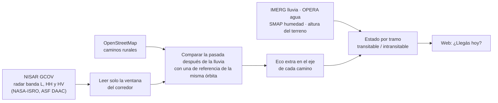
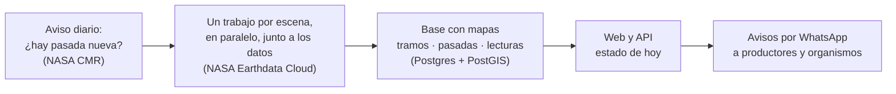
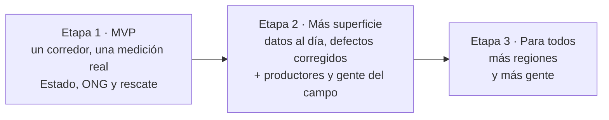

# BAQUI · El estado de los caminos rurales, visto desde el satélite

> **NASA Space Apps Challenge 2026** · Desafío *Dancing with the SARs* · Sede General San Martín, Chaco (Argentina)
>
> **Web:** [baqui-nasa.vercel.app](https://baqui-nasa.vercel.app) · **English:** [README.md](README.md)

> [!NOTE]
> **Prototipo.** **Real:** la medición del radar NISAR (NASA-ISRO) sobre 1.201,7 km de caminos rurales sin pavimento del corredor de General San Martín, Chaco. **Simulado:** el agua de la demo (sección 4) y la consola de despacho (sección 2). La web marca qué es cada cosa.

BAQUI responde una sola pregunta: **¿el camino rural está transitable después de la lluvia?** Usa el radar NISAR de NASA, que ve a través de las nubes, para que nadie tenga que ir hasta el camino a mirar.

---

## Contenido

1. [El problema](#1-el-problema)
2. [Qué hace BAQUI](#2-qué-hace-baqui)
3. [Cómo funciona](#3-cómo-funciona)
4. [Datos de NASA que usamos](#4-datos-de-nasa-que-usamos)
5. [Resultado real](#5-resultado-real)
6. [La web, sección por sección](#6-la-web-sección-por-sección)
7. [Cómo correrlo](#7-cómo-correrlo)
8. [Estructura del repo](#8-estructura-del-repo)
9. [Real y simulado](#9-real-y-simulado)
10. [Límites](#10-límites)
11. [Camino a producción y escala](#11-camino-a-producción-y-escala)
12. [Hoja de ruta](#12-hoja-de-ruta)
13. [Uso de IA](#13-uso-de-ia)
14. [Créditos y licencia](#14-créditos-y-licencia)

---

## 1. El problema

Cuando llueve en el campo, los caminos de tierra se cortan. Cruz Roja, Protección Civil, Cáritas, Vialidad y los productores **salen sin saber si el camino da paso**: despachan a ciegas, arriesgan vehículos y pierden tiempo y plata.

Justo cuando más llueve hay nubes, y los satélites que sacan "fotos" comunes no ven nada. Con El Niño, que puede intensificarse hacia fin de año y comienzos del próximo, el problema crece.

## 2. Qué hace BAQUI

| Rol | Quién | Qué obtiene |
|---|---|---|
| **Cliente** (paga el servicio) | Organismos del Estado, ONG y operaciones de rescate: Protección Civil, Vialidad, Cruz Roja, Cáritas, Bomberos | Menos vehículos varados y ayuda que llega a tiempo |
| **Usuario** (consulta antes de salir) | La persona encargada de despachar: mercadería, donaciones o una ambulancia | La respuesta a "¿llego hoy a este lugar?": **transitable o intransitable**, tramo por tramo, con el dato del radar que la respalda |
| **Beneficiados** | La gente del campo y los afectados por la lluvia y las inundaciones | Que la ayuda y los insumos lleguen a tiempo, y que la producción salga |

Todos los datos que usa BAQUI son públicos y gratis. El costo del servicio (procesar y mantener el dato al día) lo pagaría el cliente.

> **Para quién es este MVP.** Está pensado para organismos del Estado, ONG y operaciones de rescate: los que tienen que despachar una ambulancia, una donación o un equipo después de la lluvia. En la [etapa 2](#12-hoja-de-ruta) se abre también a productores rurales y gente del campo.

## 3. Cómo funciona

El radar NISAR manda una señal de radio hacia la tierra y escucha cuánto rebota (el **eco**). La señal atraviesa nubes y funciona de noche. El agua cambia el eco:

| Suelo | Qué pasa | Eco |
|---|---|---|
| **Seco** | Tierra firme | Normal |
| **Mojado** | Sin agua encima: la tierra mojada devuelve más señal | **Sube** |
| **Bajo agua** | El agua cubre el suelo y hace de espejo | **Cae** |



Paso a paso:

1. **Buscar las pasadas** de NISAR sobre la zona con la herramienta oficial de NASA (`earthaccess`, NASA Earthdata).
2. **Leer solo el corredor.** No se baja la escena entera (unos 1,8 GB): se lee por internet la ventana que importa (unos 43 MB).
3. **Ubicar los caminos** con OpenStreetMap y medir solo el centro de cada uno (píxeles a 10 m o menos del eje).
4. **Comparar** una pasada después de la lluvia con otra de referencia de la **misma órbita**, así el satélite mira desde el mismo ángulo. La diferencia es el eco extra.
5. **Clasificar** cada tramo sumando la lluvia (IMERG), el agua en superficie (OPERA) y la humedad del suelo (SMAP). El algoritmo ya acepta la altura del terreno (si el tramo está en un bajo o en una loma); calcularla tramo por tramo es parte de la etapa 2.

**Cómo se combinan los datos.** Cada satélite mide distinto, con otra grilla y otro horario. Para compararlos:

| Dato | Resolución original | Cómo lo llevamos a BAQUI |
|---|---|---|
| NISAR | 20 m | Es la grilla base: todo se proyecta a ella |
| OPERA y altura del terreno | 30 m | Se reproyectan a la grilla de NISAR |
| IMERG | ~10 km, por día UTC | Cada tramo usa su celda; se cuenta desde el día siguiente a la pasada |
| SMAP | 9 km, una vez por día | Promedio del corredor, para confirmar la tendencia |
| OpenStreetMap | Líneas | Se rasterizan: eje (10 m o menos del centro) y franjas de campo para comparar |


El detalle está en [`docs/hipotesis-fisica.md`](docs/hipotesis-fisica.md) y [`docs/algoritmo.md`](docs/algoritmo.md).

## 4. Datos de NASA que usamos

| Dato | Fuente | Para qué | En el prototipo |
|---|---|---|---|
| **NISAR L2 GCOV** (banda L, HH y HV) | NASA-ISRO, vía ASF DAAC | Eco del radar sobre los caminos | **Medido** (números de la sección 5) |
| **IMERG** (lluvia diaria) | NASA GPM | Lluvia desde la pasada, por tramo | Bajado y usado en el algoritmo |
| **OPERA DSWx-S1** (agua en superficie) | NASA JPL | Control: dónde hay agua a la vista | Usado en los chequeos |
| **Sentinel-1** (radar banda C, vía OPERA RTC) | ESA, procesado por NASA JPL | Segundo radar: ver si confirma lo de NISAR | Comparado: marcó los mismos caminos |
| **SMAP** (humedad del suelo) | NASA | Humedad de la zona | Bajado y usado como respaldo |
| **NASADEM** (altura del terreno, 30 m) | NASA | Si el tramo está en un bajo o en una loma | Fuente por defecto en el script de descarga |
| **Blue Marble** | NASA | Imagen de la Tierra en el globo 3D | En la web |
| Copernicus DEM GLO-30 | ESA (no es de NASA) | La misma altura, para comparar | Alternativa (los chequeos actuales lo usan) |
| OpenStreetMap | Comunidad OSM | Los caminos | Real |

**Próximas fuentes (etapa 2):**

| Dato | Fuente | Qué suma |
|---|---|---|
| **SAOCOM 1A y 1B** (banda L, 23,5 cm, 4 polarizaciones, hasta 10 m) | CONAE (Argentina) | Más pasadas en la misma banda que NISAR (cada 8 días con los dos satélites) y 4 polarizaciones para separar agua, suelo mojado y vegetación, sobre todo bajo el monte. Archivo gratis para el territorio argentino. Participa de la Carta Internacional de Desastres |
| **CYGNSS** (humedad del suelo y agua en superficie) | NASA | Humedad cada 6 horas (grilla de 9 km) y máscara de agua diaria (1 km): dice casi a diario si la zona se mojó entre pasadas de radar |
| **Sentinel-1 en la respuesta diaria** (banda C) | ESA / NASA JPL | Hoy es control; calibrado con NISAR, suma pasadas para tener el dato del camino más seguido |

Todos los datos son públicos y gratis. No están en el repo porque pesan varios GB: se bajan con los scripts de [`analisis/`](analisis/README.md).

## 5. Resultado real

Corredor de General San Martín (Chaco), órbita 161 ascendente, frame 164. Una pasada después de la lluvia contra otra de referencia de la misma órbita.

| Medición | Valor | Qué significa |
|---|---|---|
| Eco extra en el eje de los caminos (mediana, HH) | **+1,35 dB** | El suelo se mojó |
| Puntos del camino con más de 1 dB extra | **6 de cada 10** | No es un caso aislado |
| Sin monte: eje del camino contra campo abierto | **+1,63 dB contra +1,57 dB** | Se mojó toda la zona, no solo el camino |
| Puntos con agua abierta nueva | **3 de 53.611 (0,006 %)** | Mojado, no bajo agua |
| Caminos medidos | **1.201,7 km** | Caminos rurales sin pavimento de OpenStreetMap |

**Respaldo independiente.** Otros satélites y otras órbitas de NISAR cuentan la misma historia:

| Fuente | Qué muestra | ¿Coincide? |
|---|---|---|
| **IMERG** (lluvia, NASA) | Entre las dos pasadas llovieron unos 27 mm de media sobre el corredor, en todas las celdas; el día fuerte fue el 8/10. Los 4 días antes de la pasada de referencia, 0 mm | Sí: llovió entre las pasadas y la referencia estaba seca |
| **SMAP** (humedad del suelo, NASA) | De 0,272 m³/m³ (25/09) a **0,339 m³/m³** (11/10), el valor más alto de la serie; después baja a 0,306 (16/10) y 0,269 (19/10) | Sí: otro satélite ve el suelo mojado el mismo día, y después cómo se seca |
| **NISAR, órbita 060 ascendente** | Eco del eje +1,08 dB, 7 días después de la lluvia | Sí: otra geometría ve lo mismo |
| **NISAR, órbita 111 descendente** | Eco del eje +0,77 dB, 10 días después de la lluvia | Sí: sube menos porque el suelo se va secando |
| **OPERA** (agua en superficie, NASA) | 0 % de agua nueva sobre el eje de los caminos | Sí: mojado, no bajo agua |
| **Sentinel-1** (otro radar, banda C) | Eco +1,07 dB en la zona de San Martín después de la lluvia; los 3 caminos donde más subió (+4,5, +3,2 y +2,9 dB) también resaltan en NISAR (+3,4, +1,9 y +3,0 dB) | Sí: dos radares distintos marcan los mismos caminos |
| **Campo lejos de los caminos** | +0,17 dB | Sí: donde llovió menos, el eco casi no cambia |

**Conclusión:** el radar ve la **zona mojada**. Cada número tiene anotado su archivo de origen en [`web/src/data/resultados.json`](web/src/data/resultados.json) (campos `_fuente`). Cualquiera lo puede verificar gratis en [ASF Vertex](https://search.asf.alaska.edu/) con el ID del archivo que da la web.

## 6. La web, sección por sección

| # | Sección | Qué muestra | Carpeta |
|---|---|---|---|
| 1 | Qué es BAQUI | Globo 3D con NISAR en su órbita real (TLE de Celestrak propagado con `satellite.js`) | [`web/src/views/1-visor/`](web/src/views/1-visor/) |
| 2 | El problema | Quién sufre el camino cortado y la consola de despacho (escena ilustrativa) | [`web/src/views/2-operaciones/`](web/src/views/2-operaciones/) |
| 3 | Por qué ahora: El Niño | Salud, logística, tiempo y dinero | [`web/src/views/3-impacto/`](web/src/views/3-impacto/) |
| 4 | La demo: ¿llegás hoy? | Elegís un destino y BAQUI responde si llegás, sobre caminos reales con agua simulada | [`web/src/views/4-demo/`](web/src/views/4-demo/) |
| 5 | Cómo lo sabe BAQUI | Hipótesis física y la medición real de NISAR | [`web/src/views/5-resultados/`](web/src/views/5-resultados/) |

Todos los textos de cada sección están en su archivo `textos.ts`.

## 7. Cómo correrlo

**Web** (Next.js 16, React 19, TypeScript, Tailwind 4, three.js, Leaflet):

```bash
cd web
pnpm install
pnpm dev        # http://localhost:3000
```

**Análisis** (Python):

```bash
cd analisis
pip install -r requirements.txt   # Python 3.12+
python -m pytest -q tests   # 181 tests, no necesitan los datos
```

Para bajar los datos de NASA hace falta una cuenta gratis de [NASA Earthdata](https://urs.earthdata.nasa.gov/). Los comandos están en [`analisis/README.md`](analisis/README.md).

## 8. Estructura del repo

```
baqui-space-app/
├── web/                    La página (Next.js)
│   ├── src/views/          Una carpeta por sección (1 a 5), cada una con su textos.ts
│   ├── src/data/           resultados.json: los números reales con su fuente
│   └── public/             Imágenes
├── analisis/               La ciencia (Python)
│   ├── baqui/              Medición, clasificación, lluvia, secado y rutas
│   ├── baqui/descarga/     Bajada de datos de la NASA
│   ├── baqui/graficos/     Imágenes de antes y después
│   ├── baqui/chequeos/     Controles que generan los números de la web
│   ├── tests/              181 tests
│   └── db/                 Esquema de la base (PostgreSQL + PostGIS)
├── docs/                   Hipótesis física, algoritmo, reglas del estado y escalabilidad
│   └── pitch/              Guion del pitch y del video
└── .github/workflows/      Revisión automática de cada cambio
```

## 9. Real y simulado

| Real | Simulado o ilustrativo |
|---|---|
| Datos de NISAR y la medición de la sección 5 | El agua de la demo (sección 4) |
| Caminos y lugares de OpenStreetMap | La consola de despacho (sección 2) |
| La órbita de NISAR en el globo | La foto del pie de página: es de Veracruz, México, no del corredor medido |
| Imagen de la Tierra (NASA Blue Marble) | |

## 10. Límites

- **El radar mide la zona, no solo el camino.** A esta resolución el camino y el campo de alrededor suben casi igual. Por eso decimos "zona mojada".
- **Bajo el monte no se confirma agua.** El 38,1 % del eje de los caminos tiene monte.
- **El resultado principal es un par de pasadas**, respaldado por otras dos órbitas de NISAR, SMAP e IMERG. Falta validarlo en el terreno.
- **Una duda abierta:** un par de 14 días da -0,65 dB en la zona, pero mezcla dos versiones del procesador de NISAR, así que no se puede comparar directo.
- **El estado por tramo y el secado día a día están programados pero no calibrados.** La demo usa agua simulada.
- **Frecuencia:** NISAR repite órbita cada 12 días. Sobre el corredor pasaron 3 órbitas distintas en 12 días, así que hay un dato nuevo cada unos 4 días.
- **Los productos de NISAR son provisionales** y hoy se publican con atraso.

## 11. Camino a producción y escala

**La idea central: NASA guarda las imágenes, BAQUI guarda solo la respuesta.**

| Qué | Tamaño | Cómo lo sabemos |
|---|---|---|
| Una escena completa de NISAR | ~1,8 GB | Medido |
| La ventana del corredor que leemos | ~43 MB | Medido (ya funciona así) |
| El resultado de una pasada (12.017 tramos de 100 m) | ~1,2 MB | Estimado con el esquema de la base |

Unas 1.500 veces menos de lo que hay que guardar. Con unas 91 pasadas por año sobre el corredor, la base crece unos 105 MB por año. Para 100.000 km de caminos, lo que se consulta (el estado de hoy, una fila por tramo) ocupa unos 75 MB, y el historial va a archivos comprimidos en un almacenamiento barato.

Cuentas, arquitectura y esquema: [`docs/escalabilidad.md`](docs/escalabilidad.md) y [`analisis/db/schema.sql`](analisis/db/schema.sql) (PostgreSQL + PostGIS).

Arquitectura propuesta:



Cada lectura guarda el ID del archivo de NASA, así cualquiera puede rehacer el cálculo.

## 12. Hoja de ruta



### Etapa 1 · MVP (hecha, Space Apps 2026)

- Medición real de NISAR sobre **1.201,7 km** de caminos rurales del corredor de General San Martín (Chaco): **+1,35 dB**, zona mojada.
- La hipótesis física probada en una comparación (pasada después de la lluvia contra una de referencia de la misma órbita).
- Web con la demo "¿Llegás hoy?" sobre caminos reales (agua simulada), verificable gratis en ASF Vertex.
- Algoritmo programado: estado por tramo, lluvia desde la pasada (IMERG) y secado. 181 tests.
- Público: organismos del Estado, ONG y operaciones de rescate.

### Etapa 2 · Más superficie, datos al día, defectos corregidos y productores

- **Más público:** se suman los productores rurales y la gente del campo, que consultan su camino antes de salir.
- **Más superficie:** del corredor a toda la provincia del Chaco y después al NEA.
- **Datos al día, solos:** un aviso diario busca pasadas nuevas de NISAR y las procesa sin intervención (arquitectura de la [sección 11](#11-camino-a-producción-y-escala)). La lluvia (IMERG) y la humedad (SMAP) actualizan el estado todos los días entre pasadas.
- **Más pasadas:** sumar SAOCOM (radar argentino de CONAE, banda L como NISAR) y Sentinel-1 / OPERA para tener un dato del camino más seguido, y CYGNSS (NASA) para saber casi a diario si la zona se mojó.
- **Defectos a corregir** (ver [Límites](#10-límites)):
  - Calibrar el estado por tramo y el secado con muchas pasadas, no con una.
  - Validar en el terreno con Vialidad, Protección Civil y productores: fotos del camino el mismo día de la pasada.
  - Medir tramo por tramo (cada 100 m) y separar mejor el camino del campo, usando las dos polarizaciones (HH y HV).
  - Bajo el monte: confirmar el agua con otras fuentes.
  - Reemplazar el agua simulada de la demo por la medición real.
- **Armonizar los datos y dar un nivel de confianza por tramo:**
  - Una grilla y un reloj comunes para todas las fuentes, con controles de calidad (pasadas con dato faltante, cambio de versión del procesador).
  - Altura del terreno con NASADEM: calcular el HAND (altura sobre el drenaje más cercano) de cada tramo.
  - Confianza **alta** cuando dos fuentes independientes coinciden (por ejemplo, NISAR más SAOCOM o dos órbitas de NISAR en los últimos 4 días) y la humedad de la zona (SMAP o CYGNSS) va para el mismo lado; **media** con una sola fuente; **baja** si se contradicen o el dato es viejo. Cada respuesta dice de cuándo es el dato.
  - Medir los aciertos contra lo que se ve en el terreno y ajustar los umbrales con esos datos.
- **Web en inglés y en español.**

### Etapa 3 · Más regiones y más gente

- **Más superficie:** el resto de Argentina y otros países con caminos de tierra y temporadas de lluvia. NISAR cubre todo el planeta.
- **Todavía más público:** transportistas, escuelas rurales y cualquier persona que tenga que salir por un camino de tierra.
- **Donde la gente ya está:** consulta y avisos por WhatsApp ("¿llego hoy a…?"), un mapa público y una API para Vialidad, Protección Civil y las ONG.
- **La meta:** que no se pierda producción, plata ni tiempo, y que las ambulancias y las donaciones lleguen a tiempo. Para comprobar que se cumple, medimos cuántas respuestas acierta BAQUI contra lo que se ve en el terreno, y cuánto tiempo ahorran los despachos.

## 13. Uso de IA

Las reglas de Space Apps 2026 piden contar cómo usamos la IA.

| Quién | Qué hizo |
|---|---|
| **El equipo** | La idea, el diseño del producto, la misión y la visión, y las correcciones: decidió y aprobó cada texto y cada cambio de diseño. |
| **IA: Claude Code** (Anthropic) | La programación: la web (Next.js, globo con three.js, demo con Leaflet) y los scripts de Python que bajan y miden NISAR. Sus commits llevan `Co-Authored-By: Claude`. También ayudó a redactar la documentación técnica a partir de lo que decidió el equipo, y a cotejar cada número contra su archivo de origen. |
| **IA: modelos gratuitos** (vía FreeLLMAPI) | Leer y resumir fuentes públicas. Nunca recibieron datos privados. |

**Qué no sale de la IA:** los números (salen de correr nuestros scripts sobre datos reales de NASA), la imagen de la Tierra (NASA Blue Marble), la foto del pie de página (foto real de Wikimedia Commons) y los caminos (OpenStreetMap). No hay imágenes generadas con IA.

## 14. Créditos y licencia

- **Código:** licencia [MIT](LICENSE).
- **Datos:** NASA (NISAR con ISRO, IMERG, OPERA, SMAP, NASADEM, Blue Marble), datos públicos. Sentinel-1 (a través de OPERA) y Copernicus DEM GLO-30 de la ESA.
- **Caminos:** © colaboradores de [OpenStreetMap](https://www.openstreetmap.org/copyright), licencia ODbL.
- **Mosaico satelital del mapa de la demo:** [Sentinel-2 cloudless 2023](https://s2maps.eu) de EOX IT Services GmbH (datos modificados de Copernicus Sentinel 2023), licencia CC BY-NC-SA 4.0 (solo uso no comercial).
- **Órbita de NISAR en el globo:** TLE de [Celestrak](https://celestrak.org/NORAD/elements/gp.php?NAME=NISAR&FORMAT=TLE).
- **Pronóstico de lluvia** (script auxiliar [`analisis/baqui/pronostico.py`](analisis/baqui/pronostico.py), todavía sin conectar al estado por tramo): [Open-Meteo](https://open-meteo.com/), o Meteomatics si hay una cuenta configurada.
- **Foto del pie de página:** "Camino inundado en Salinas, Alvarado, Veracruz 01", de Isaacvp, [Wikimedia Commons](https://commons.wikimedia.org/wiki/File:Camino_inundado_en_Salinas,_Alvarado,_Veracruz_01.jpg), licencia CC BY-SA 4.0. Adaptada (recorte y tono), con la misma licencia.
- BAQUI no está afiliado a NASA ni la representa.
