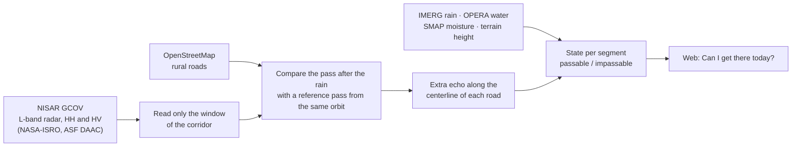
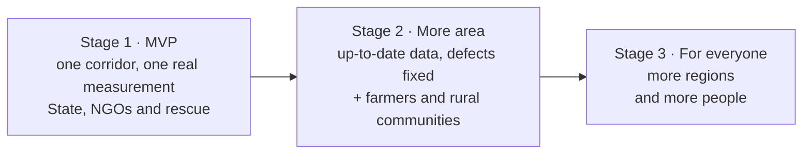

# BAQUI · The state of rural roads, seen from space

> **NASA Space Apps Challenge 2026** · Challenge *Dancing with the SARs* · Host city General San Martín, Chaco (Argentina)
>
> **Web:** [baqui-nasa.vercel.app](https://baqui-nasa.vercel.app) · **Español:** [README.es.md](README.es.md)

> [!NOTE]
> **Prototype.** **Real:** the NISAR (NASA-ISRO) radar measurement over 1,201.7 km of unpaved rural roads in the General San Martín corridor, Chaco. **Simulated:** the water in the demo (section 4) and the dispatch console (section 2). The web marks which is which.

BAQUI answers a single question: **is the rural road passable after the rain?** It uses NASA's NISAR radar, which sees through clouds, so that nobody has to go to the road to look.

---

## Contents

1. [The problem](#1-the-problem)
2. [What BAQUI does](#2-what-baqui-does)
3. [How it works](#3-how-it-works)
4. [NASA data we use](#4-nasa-data-we-use)
5. [Real result](#5-real-result)
6. [The web, section by section](#6-the-web-section-by-section)
7. [How to run it](#7-how-to-run-it)
8. [Repo structure](#8-repo-structure)
9. [Real and simulated](#9-real-and-simulated)
10. [Limits](#10-limits)
11. [Path to production and scale](#11-path-to-production-and-scale)
12. [Roadmap](#12-roadmap)
13. [Use of AI](#13-use-of-ai)
14. [Credits and license](#14-credits-and-license)

---

## 1. The problem

When it rains in the countryside, dirt roads get cut off. Red Cross, Civil Protection, Cáritas, the roads agency (Vialidad) and farmers **set out without knowing whether the road can be crossed**: they dispatch blindly, risk vehicles and lose time and money.

Heavy rain comes with clouds, and satellites that take ordinary "photos" see nothing. With El Niño, which may intensify toward the end of the year and the start of the next, the problem grows.

## 2. What BAQUI does

| Role | Who | What they get |
|---|---|---|
| **Customer** (pays for the service) | State agencies, NGOs and rescue operations: Civil Protection, the roads agency (Vialidad), Red Cross, Cáritas, firefighters | Fewer stranded vehicles and aid that arrives on time |
| **User** (checks before leaving) | The person in charge of dispatching: goods, donations or an ambulance | The answer to "can I get there today?": **passable or impassable**, segment by segment, with the radar data behind it |
| **Beneficiaries** | Rural communities and people affected by rain and floods | Aid and supplies arrive on time, and production gets out |

All the data BAQUI uses is public and free. The cost of the service (processing and keeping the data up to date) would be paid by the customer.

> **Who this MVP is for.** It is designed for State agencies, NGOs and rescue operations: those who have to dispatch an ambulance, a donation or a crew after the rain. In [stage 2](#12-roadmap) it also opens to farmers and rural communities.

## 3. How it works

The NISAR radar sends a radio signal toward the ground and listens to how much bounces back (the **echo**). The signal goes through clouds and works at night. Water changes the echo:

| Ground | What happens | Echo |
|---|---|---|
| **Dry** | Firm ground | Normal |
| **Wet** | No standing water: wet soil returns more signal | **Rises** |
| **Under water** | Water covers the ground and acts as a mirror | **Drops** |



Step by step:

1. **Find the passes** of NISAR over the area with NASA's official tool (`earthaccess`, NASA Earthdata).
2. **Read only the corridor.** The whole scene (about 1.8 GB) is not downloaded: the window that matters (about 43 MB) is read over the internet.
3. **Locate the roads** with OpenStreetMap and measure only the center of each one (pixels within 10 m of the centerline).
4. **Compare** a pass after the rain with a reference pass from the **same orbit**, so the satellite looks from the same angle. The difference is the extra echo.
5. **Classify** each segment by adding rainfall (IMERG), surface water (OPERA) and soil moisture (SMAP). The algorithm already accepts terrain height (whether the segment lies in a low spot or on a rise); computing it for every segment is part of stage 2.

**How the data are combined.** Each satellite measures differently, on another grid and at another time. To compare them:

| Data | Original resolution | How BAQUI aligns it |
|---|---|---|
| NISAR | 20 m | Base grid: everything is projected onto it |
| OPERA and terrain height | 30 m | Reprojected onto the NISAR grid |
| IMERG | ~10 km, per UTC day | Each segment uses its own cell; counted from the day after the pass |
| SMAP | 9 km, once a day | Corridor average, to confirm the trend |
| OpenStreetMap | Lines | Rasterized: centerline (within 10 m) and field strips for comparison |


The details are in [`docs/hipotesis-fisica.md`](docs/hipotesis-fisica.md) and [`docs/algoritmo.md`](docs/algoritmo.md).

## 4. NASA data we use

| Data | Source | Used for | In the prototype |
|---|---|---|---|
| **NISAR L2 GCOV** (L-band, HH and HV) | NASA-ISRO, via ASF DAAC | Radar echo over the roads | **Measured** (numbers in section 5) |
| **IMERG** (daily rainfall) | NASA GPM | Rainfall since the pass, per segment | Downloaded and used in the algorithm |
| **OPERA DSWx-S1** (surface water) | NASA JPL | Control: where water is visible | Used in the checks |
| **Sentinel-1** (C-band radar, via OPERA RTC) | ESA, processed by NASA JPL | Second radar: does it confirm NISAR? | Compared: it flagged the same roads |
| **SMAP** (soil moisture) | NASA | Moisture of the area | Downloaded and used as corroboration |
| **NASADEM** (terrain height, 30 m) | NASA | Whether the segment lies in a low spot or on a rise | Default source in the download script |
| **Blue Marble** | NASA | Image of the Earth on the 3D globe | On the web |
| Copernicus DEM GLO-30 | ESA (not NASA) | Same terrain height, for comparison | Alternative (used by the current checks) |
| OpenStreetMap | OSM community | The roads | Real |

**Next sources (stage 2):**

| Data | Source | What it adds |
|---|---|---|
| **SAOCOM 1A and 1B** (L-band, 23.5 cm, 4 polarizations, down to 10 m) | CONAE (Argentina) | More passes in the same band as NISAR (every 8 days with both satellites) and 4 polarizations to separate water, wet soil and vegetation, especially under forest. Free archive for Argentine territory. Part of the International Charter on Space and Major Disasters |
| **CYGNSS** (soil moisture and surface water) | NASA | Soil moisture every 6 hours (9 km grid) and a daily water mask (1 km): tells almost daily whether the area got wet between radar passes |
| **Sentinel-1 in the daily answer** (C-band) | ESA / NASA JPL | Today it is a control; once calibrated against NISAR, it adds passes to get road data more often |

All data are public and free. They are not in the repo because they weigh several GB: they are downloaded with the scripts in [`analisis/`](analisis/README.md).

## 5. Real result

General San Martín corridor (Chaco), ascending orbit 161, frame 164. A pass after the rain against a reference pass from the same orbit.

| Measurement | Value | What it means |
|---|---|---|
| Extra echo along the road centerline (median, HH) | **+1.35 dB** | The ground got wet |
| Road points with more than 1 dB extra | **6 out of 10** | Not an isolated case |
| Without forest: road centerline against open field | **+1.63 dB vs +1.57 dB** | The whole area got wet, not just the road |
| Points with new open water | **3 of 53,611 (0.006%)** | Wet, not under water |
| Roads measured | **1,201.7 km** | Unpaved rural roads from OpenStreetMap |

**Independent corroboration.** Other satellites and other NISAR orbits tell the same story:

| Source | What it shows | Does it agree? |
|---|---|---|
| **IMERG** (rainfall, NASA) | About 27 mm on average fell over the corridor between the two passes, in every cell; the heavy day was 8 Oct. The 4 days before the reference pass: 0 mm | Yes: it rained between the passes and the reference was dry |
| **SMAP** (soil moisture, NASA) | From 0.272 m³/m³ (25 Sep) to **0.339 m³/m³** (11 Oct), the highest value in the series; then down to 0.306 (16 Oct) and 0.269 (19 Oct) | Yes: another satellite sees wet soil the same day, and then the drying |
| **NISAR, ascending orbit 060** | Centerline echo +1.08 dB, 7 days after the rain | Yes: another geometry sees the same |
| **NISAR, descending orbit 111** | Centerline echo +0.77 dB, 10 days after the rain | Yes: it rises less because the soil is drying |
| **OPERA** (surface water, NASA) | 0% new water on the road centerline | Yes: wet, not under water |
| **Sentinel-1** (another radar, C-band) | Echo +1.07 dB over the San Martín area after the rain; the 3 roads where it rose most (+4.5, +3.2 and +2.9 dB) also stand out in NISAR (+3.4, +1.9 and +3.0 dB) | Yes: two different radars flag the same roads |
| **Field far from the roads** | +0.17 dB | Yes: where it rained less, the echo barely changes |

**Conclusion:** the radar sees the **wet area**. Each number has its source file noted in [`web/src/data/resultados.json`](web/src/data/resultados.json) (`_fuente` fields). Anyone can verify it for free in [ASF Vertex](https://search.asf.alaska.edu/) with the file ID given by the web.

## 6. The web, section by section

| # | Section | What it shows | Folder |
|---|---|---|---|
| 1 | What BAQUI is | 3D globe with NISAR in its real orbit (Celestrak TLE propagated with `satellite.js`) | [`web/src/views/1-visor/`](web/src/views/1-visor/) |
| 2 | The problem | Who suffers from the cut road, and the dispatch console (illustrative scene) | [`web/src/views/2-operaciones/`](web/src/views/2-operaciones/) |
| 3 | Why now: El Niño | Health, logistics, time and money | [`web/src/views/3-impacto/`](web/src/views/3-impacto/) |
| 4 | The demo: will you get there today? (¿Llegás hoy?) | You pick a destination and BAQUI answers whether you can get there, on real roads with simulated water | [`web/src/views/4-demo/`](web/src/views/4-demo/) |
| 5 | How BAQUI knows | Physical hypothesis and the real NISAR measurement | [`web/src/views/5-resultados/`](web/src/views/5-resultados/) |

All the texts of each section are in its `textos.ts` file.

## 7. How to run it

**Web** (Next.js 16, React 19, TypeScript, Tailwind 4, three.js, Leaflet):

```bash
cd web
pnpm install
pnpm dev        # http://localhost:3000
```

**Analysis** (Python):

```bash
cd analisis
pip install -r requirements.txt   # Python 3.12+
python -m pytest -q tests   # 178 tests, they do not need the data
```

To download the NASA data you need a free [NASA Earthdata](https://urs.earthdata.nasa.gov/) account. The commands are in [`analisis/README.md`](analisis/README.md).

## 8. Repo structure

```
baqui-space-app/
├── web/                    The page (Next.js)
│   ├── src/views/          One folder per section (1 to 5), each with its textos.ts
│   ├── src/data/           resultados.json: the real numbers with their source
│   └── public/             Images
├── analisis/               The science (Python)
│   ├── baqui/              Measurement, classification, rainfall, drying and routing
│   ├── baqui/descarga/     NASA data download
│   ├── baqui/graficos/     Before and after images
│   ├── baqui/chequeos/     Checks that generate the numbers on the web
│   ├── tests/              178 tests
│   └── db/                 Database schema (PostgreSQL + PostGIS)
├── docs/                   Physical hypothesis, algorithm, state rules and scalability
│   └── pitch/              Pitch and video script
└── .github/workflows/      Automatic checks on every change
```

## 9. Real and simulated

| Real | Simulated or illustrative |
|---|---|
| NISAR data and the measurement in section 5 | The water in the demo (section 4) |
| Roads and places from OpenStreetMap | The dispatch console (section 2) |
| The NISAR orbit on the globe | The footer photo: it is from Veracruz, Mexico, not from the measured corridor |
| Image of the Earth (NASA Blue Marble) | |

## 10. Limits

- **The radar measures the area, not just the road.** At this resolution the road and the surrounding field rise almost equally. That is why we say "wet area".
- **Water under forest is not confirmed.** 38.1% of the road centerline has forest.
- **The main result is one pair of passes**, backed by two other NISAR orbits, SMAP and IMERG. It still needs validation on the ground.
- **One open question:** a 14-day pair gives -0.65 dB over the area, but it mixes two versions of the NISAR processor, so it cannot be compared directly.
- **The state per segment and the day-by-day drying are programmed but not calibrated.** The demo uses simulated water.
- **Frequency:** NISAR repeats its orbit every 12 days. Over the corridor, 3 different orbits passed in 12 days, so there is new data about every 4 days.
- **NISAR products are provisional** and are currently published with a delay.

## 11. Path to production and scale

**The central idea: NASA stores the images, BAQUI stores only the answer.**

| What | Size | How we know |
|---|---|---|
| A full NISAR scene | ~1.8 GB | Measured |
| The corridor window we read | ~43 MB | Measured (it already works this way) |
| The result of one pass (12,017 segments of 100 m) | ~1.2 MB | Estimated from the database schema |

About 1,500 times less to store. With about 91 passes per year over the corridor, the database grows about 105 MB per year. For 100,000 km of roads, what is queried (today's state, one row per segment) takes about 75 MB, and the history goes to compressed files in cheap storage.

Numbers, architecture and schema: [`docs/escalabilidad.md`](docs/escalabilidad.md) and [`analisis/db/schema.sql`](analisis/db/schema.sql) (PostgreSQL + PostGIS).

Proposed architecture:


Each reading stores the ID of the NASA file, so anyone can redo the calculation.

## 12. Roadmap



### Stage 1 · MVP (done, Space Apps 2026)

- Real NISAR measurement over **1,201.7 km** of rural roads in the General San Martín corridor (Chaco): **+1.35 dB**, wet area.
- The physical hypothesis tested in one comparison (a pass after the rain against a reference pass from the same orbit).
- Web with the "Will you get there today?" demo on real roads (simulated water), verifiable for free in ASF Vertex.
- Algorithm programmed: state per segment, rainfall since the pass (IMERG) and drying. 178 tests.
- Audience: State agencies, NGOs and rescue operations.

### Stage 2 · More area, up-to-date data, defects fixed and farmers

- **Wider audience:** farmers and rural communities join, checking their road before they leave.
- **More area:** from the corridor to the whole province of Chaco, then to Northeast Argentina.
- **Data kept up to date automatically:** a daily check finds new NISAR passes and processes them with no manual step (architecture in [section 11](#11-path-to-production-and-scale)). Rainfall (IMERG) and soil moisture (SMAP) update the state every day between passes.
- **More passes:** add SAOCOM (Argentina's CONAE radar, L-band like NISAR) and Sentinel-1 / OPERA to get road data more often, and CYGNSS (NASA) to know almost daily whether the area got wet.
- **Defects to fix** (see [Limits](#10-limits)):
  - Calibrate the state per segment and the drying with many passes, not one.
  - Validate on the ground with the roads agency, Civil Protection and farmers: photos of the road on the day of the pass.
  - Measure segment by segment (every 100 m) and better separate the road from the field, using both polarizations (HH and HV).
  - Under forest: confirm water with other sources.
  - Replace the simulated water in the demo with the real measurement.
- **Harmonize the data and give a confidence level per segment:**
  - A common grid and clock for every source, with quality checks (passes with missing data, processor version changes).
  - Terrain height with NASADEM: compute HAND (height above the nearest drainage) for every segment.
  - **High** confidence when two independent sources agree (for example NISAR plus SAOCOM, or two NISAR orbits in the last 4 days) and area moisture (SMAP or CYGNSS) points the same way; **medium** with a single source; **low** if they contradict each other or the data is old. Every answer says how old its data is.
  - Measure hits against what is seen on the ground and tune the thresholds with that data.
- **Web in English and Spanish.**

### Stage 3 · More regions and more people

- **More area:** the rest of Argentina and other countries with dirt roads and rainy seasons. NISAR covers the whole planet.
- **Even wider audience:** truck drivers, rural schools and anyone who has to travel on a dirt road.
- **Where people already are:** queries and alerts over WhatsApp ("can I get to … today?"), a public map and an API for the roads agency, Civil Protection and NGOs.
- **The goal:** no lost production, money or time, and ambulances and donations that arrive on time. To check that it works, we measure how many BAQUI answers match what is seen on the ground, and how much time dispatches save.

## 13. Use of AI

The Space Apps 2026 rules ask us to state how we used AI.

| Who | What they did |
|---|---|
| **The team** | The idea, the product design, the mission and vision, and the corrections: decided and approved every text and every design change. |
| **AI: Claude Code** (Anthropic) | The programming: the web (Next.js, three.js globe, Leaflet demo) and the Python scripts that download and measure NISAR. Its commits carry `Co-Authored-By: Claude`. It also helped draft the technical documentation from the team's decisions, and checked every number against its source file. |
| **AI: free models** (via FreeLLMAPI) | Reading and summarizing public sources. They never received private data. |

**What does not come from AI:** the numbers (they come from running our scripts on real NASA data), the image of the Earth (NASA Blue Marble), the footer photo (a real photo from Wikimedia Commons) and the roads (OpenStreetMap). There are no AI-generated images.

## 14. Credits and license

- **Code:** [MIT](LICENSE) license.
- **Data:** NASA (NISAR with ISRO, IMERG, OPERA, SMAP, NASADEM, Blue Marble), public data. Sentinel-1 (through OPERA) and Copernicus DEM GLO-30 from ESA.
- **Roads:** © [OpenStreetMap](https://www.openstreetmap.org/copyright) contributors, ODbL license.
- **Satellite mosaic of the demo map:** [Sentinel-2 cloudless 2023](https://s2maps.eu) by EOX IT Services GmbH (contains modified Copernicus Sentinel data 2023), CC BY-NC-SA 4.0 license (non-commercial use only).
- **NISAR orbit on the globe:** TLE from [Celestrak](https://celestrak.org/NORAD/elements/gp.php?NAME=NISAR&FORMAT=TLE).
- **Rain forecast** (helper script [`analisis/baqui/pronostico.py`](analisis/baqui/pronostico.py), not yet connected to the state per segment): [Open-Meteo](https://open-meteo.com/), or Meteomatics when an account is configured.
- **Footer photo:** "Camino inundado en Salinas, Alvarado, Veracruz 01", by Isaacvp, [Wikimedia Commons](https://commons.wikimedia.org/wiki/File:Camino_inundado_en_Salinas,_Alvarado,_Veracruz_01.jpg), CC BY-SA 4.0 license. Adapted (crop and tone), under the same license.
- BAQUI is not affiliated with NASA and does not represent it.
