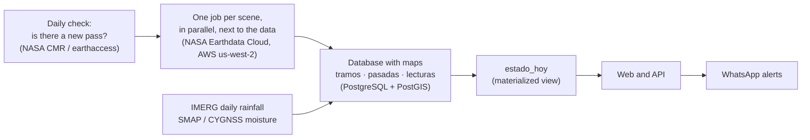

# BAQUI · Scalability and storage

**Español:** resumen en la [sección 11 del README](../README.es.md#11-camino-a-producción-y-escala).

## The central idea

**NASA stores the images. BAQUI stores only the answer.**

NISAR data are archived permanently and for free by NASA (ASF DAAC, NASA Earthdata Cloud). BAQUI never keeps a scene: it reads only the window it needs, measures each road segment and saves one small row per segment and pass. Every row keeps the ID of the NASA file, so anyone can redo the calculation.

## Sizes

| Item | Size | How we know |
|---|---|---|
| One full NISAR GCOV scene | ~1.8 GB | Measured (one file from 29 Sep 2026) |
| The corridor window we read over the internet | ~43 MB | Measured: `analisis/baqui/descarga/bajar_nisar.py` already reads only this window |
| The result of one pass over the corridor (12,017 segments of 100 m) | ~1.2 MB | Estimated from the schema (see below) |

From 1.8 GB to about 1.2 MB: roughly **1,500 times less** to store per pass.

### How the 1.2 MB is estimated

Schema: [`analisis/db/schema.sql`](../analisis/db/schema.sql) (PostgreSQL + PostGIS). One pass writes one row per segment in `lecturas`:

| Part | Bytes per segment |
|---|---|
| Row: 24 (PostgreSQL row header) + 24 (8 fixed-size fields) + 4 (line pointer) | 52 |
| Primary key index (`tramo_id`, `pasada_id`), at 90 % fill | ~22 |
| Index on `pasada_id`, at 90 % fill | ~22 |
| **Total** | **~96** |

12,017 segments × ~96 bytes ≈ **1.2 MB per pass**.

Segments: 1,201.7 km of unpaved rural roads from OpenStreetMap, cut every 100 m.

## How it grows

| Scenario | Passes | Size | Fits in |
|---|---|---|---|
| Corridor today (1,201.7 km) | ~91 per year (3 NISAR orbits every 12 days, measured over the corridor) | ~105 MB per year of history | A free database plan (500 MB) for about 4 to 5 years |
| 100,000 km of roads: what the web reads (`estado_hoy`, one row per segment) | — | ~75 MB (1,000,000 segments × ~74 bytes) | Any small database |
| 100,000 km of roads: full history | ~91 per year | ~9 GB per year in the database | Keep the last 30 days in the database and move older passes to compressed files (Parquet) in object storage, which costs cents per GB per month |

The road table itself (`tramos`, with geometry) is written once and changes only when OpenStreetMap changes.

All figures except the first two rows of "Sizes" are estimates. They become measurements in stage 2, when the pipeline loads real passes into the database.

## Architecture

1. **Detect.** A daily scheduled job asks NASA's catalog (CMR) for new NISAR passes over the area.
2. **Process.** One job per scene, in parallel. Running next to the data (same cloud region as NASA Earthdata Cloud) avoids downloading anything over the internet. Each job reads only the window, measures every segment against the reference pass of the same orbit and writes the rows.
3. **Store.** Three tables: `tramos` (segments), `pasadas` (each radar file, with its ID, orbit and processor version) and `lecturas` (what each pass measured on each segment). `lluvia_diaria` holds IMERG rainfall to update the state between passes.
4. **Serve.** The web reads only `estado_hoy`: the latest state of each segment and how old its data is.

## Why this scales

- **Work grows with new passes, not with history.** Each scene is processed once.
- **Scenes are independent.** More area means more jobs in parallel, not a bigger server.
- **What users query is small.** One row per segment, whatever the history size.
- **The data are verifiable.** Every reading points to a public NASA file.
- **New sources plug into the same tables.** SAOCOM and Sentinel-1 are new rows in `pasadas` (the `satelite` column).
